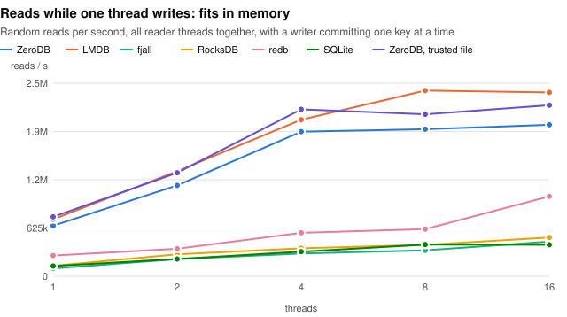
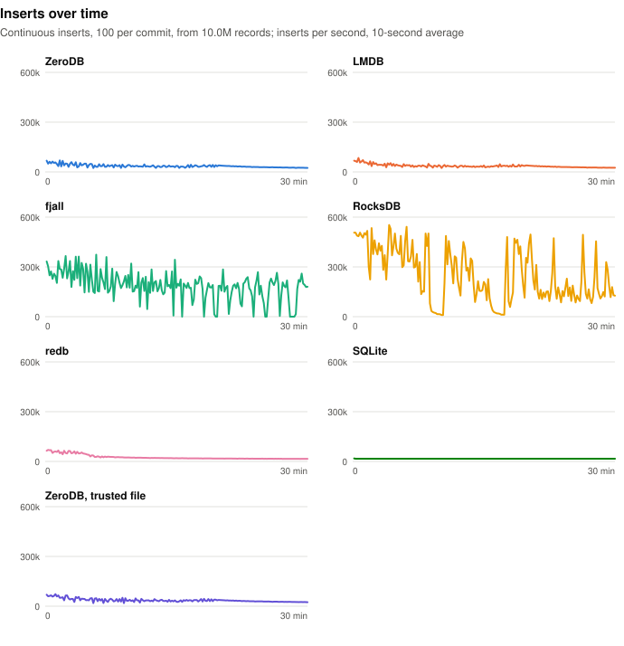

# ZeroDB

**A pure-Rust embedded key-value store, built on LMDB's design.**

Transactional, memory-mapped, fully ACID — LMDB's architecture (single writer,
lock-free MVCC readers, copy-on-write B+trees, durable meta pages) reimplemented
in safe Rust. No C, no `libc` build dance, no LMDB linked. It speaks the
[heed](https://github.com/meilisearch/heed) 0.22 API, so you can use it on its
own or drop it under any heed/LMDB consumer — and every operation is verified
against real LMDB.

```toml
# Use the engine directly:
zerodb = "0.2"

# …or drop it under a heed/LMDB consumer — one line, no code changes:
[patch.crates-io]
heed = { git = "https://github.com/qdequele/ZeroDB", tag = "v0.2.0" }
```

```rust
use zerodb::EnvOpenOptions;

let env = EnvOpenOptions::new().map_size(10 * 1024 * 1024).max_dbs(4).open("books.db")?;

let mut wtxn = env.write_txn()?;
let db = env.create_database(&mut wtxn, Some(&b"books"[..]))?;
db.put(&mut wtxn, b"1984", b"Orwell")?;
wtxn.commit()?;

let rtxn = env.read_txn()?;             // lock-free MVCC snapshot
assert_eq!(db.get(&rtxn, b"1984")?, Some(&b"Orwell"[..]));
```

## What you get

- **LMDB in safe Rust** — same architecture and semantics, no C in your build;
  `unsafe` is confined to a few audited spots (mmap, page casts), each with a
  `SAFETY:` contract.
- **Verified, not hoped** — every operation runs against the real LMDB fork
  side-by-side and is diffed, and a differential fuzzer has driven hundreds of
  thousands of op sequences with zero unresolved divergences (it even found a bug
  [in LMDB itself](docs/UPSTREAM-BUGS.md)). A fault-injection harness checks crash
  recovery; the MVCC protocol is model-checked under loom.
- **Drop-in for heed** — Meilisearch and hannoy run unmodified, at LMDB-level
  performance.
- **Beyond LMDB** — nested read transactions inside a write transaction, reader
  introspection, streamed compaction with an atomic destination.

## Status

**0.2** — the first published release ([release notes](CHANGELOG.md),
[crates.io](https://crates.io/crates/zerodb), prebuilt `zerodb-tools` on the
[releases page](https://github.com/qdequele/ZeroDB/releases)). LMDB parity is
complete and verified; Meilisearch v1.53.1 and hannoy run on it unmodified. Not yet production-hardened on the
target hardware: Graviton4 benchmarks have run, but the 24 h fuzz soak and a
64K-page-kernel run are still open — see [`CHANGELOG.md`](CHANGELOG.md).

Two things to know: the data file is **not** an LMDB file (own format; migrate
with `zerodb-tools`), and keys are ≤ 511 bytes. The on-disk format is version 2: files from development builds before
2026-10-05 (version 1) are refused at open and need a `zerodb-tools` dump and
reload. Full
list: [`docs/COMPATIBILITY.md`](docs/COMPATIBILITY.md).

## Performance

**In Meilisearch, ZeroDB is as fast as LMDB.** Indexing takes the same time
(+1% on the movies dataset, −1% when adding documents to hackernews), search is
6% faster and vector search (hannoy) 5% faster.
([hannoy run](benches/results/2026-09-28-evening-bench-server-linux-x86.md);
Meilisearch run of 2026-10-05.)

**Against other embedded key-value stores.** No store wins everything.
LMDB and ZeroDB answer reads fastest, and their readers stay fast while
another thread writes. fjall and RocksDB write and load much faster, and use
less disk, but they pause writes now and then to reorganise their files.

| | ZeroDB | LMDB | fjall | RocksDB | redb | SQLite |
|---|---|---|---|---|---|---|
| Design | B+ tree, memory-mapped | B+ tree, memory-mapped | LSM tree | LSM tree | Copy-on-write B-tree | B-tree |
| Written in | Rust | C | Rust | C++ | Rust | C |
| Writers at the same time | 1 | 1 | Many | Many | 1 | 1 |
| Several processes on one database | Yes | Yes | No | One writer, read-only others | One writer, read-only others | Yes |
| Largest key | 511 bytes | 511 bytes | 64 KiB | No practical limit | No practical limit | No practical limit |

An LSM tree appends every write to a log and sorts the data in the
background; a B-tree updates its pages in place (or, for LMDB, ZeroDB and
redb, writes changed pages to new places).

How we measured: every record has a 16-byte key and a 100-byte random value.
One data set fits in memory (10 M records, 1.2 GB), the other does not
(100 M records, 12 GB). Each test runs in its own process limited to 8 GB of
memory, starts after a 20-second warm-up and lasts 60 seconds. Keys are read
and written in random order. Engines with their own cache get 2 GB of it;
LMDB and ZeroDB use the operating system's file cache instead. Run on
2026-10-27 on an AWS Graviton4 server (4 cores, 16 GB of memory, local SSD).

**Throughput** — thousands of operations per second (higher is better, best in
**bold**). "Saved to disk" means each write waits until it is on disk; the
other writes don't wait, so a crash can lose the last ones.

| Data fits in memory | ZeroDB | LMDB | fjall | RocksDB | redb | SQLite |
|---|---:|---:|---:|---:|---:|---:|
| Read one key | 756 | **844** | 240 | 344 | 542 | 290 |
| Read one key, 16 threads | 2,300 | **2,700** | 879 | 1,300 | 1,200 | 771 |
| Read 100 keys in order | 234 | **280** | 32 | 44 | 139 | 65 |
| Read, 8 threads, while one thread writes | 1,900 | **2,400** | 346 | 408 | 612 | 411 |
| Write one key, saved to disk | 5.2 | 3.8 | 15.2 | 11.2 | 3.8 | **16.2** |
| Write 1,000 keys at a time | 64 | 75 | 280 | **504** | 65 | 27 |
| Load the data set | 141 | 176 | 409 | **600** | 146 | 19 |

| Data larger than memory | ZeroDB | LMDB | fjall | RocksDB | redb | SQLite |
|---|---:|---:|---:|---:|---:|---:|
| Read one key | 23.7 | **24.2** | 18.4 | 10.2 | 19.5 | 20.8 |
| Read one key, 16 threads | 122 | 123 | 90 | **128** | 103 | 110 |
| Read 100 keys in order | 4.3 | 4.4 | 3.6 | **5.9** | 3.7 | 4.7 |
| Read, 8 threads, while one thread writes | 111 | 111 | 53 | 50 | 75 | **136** |
| Write one key, saved to disk | 4.5 | 3.4 | **13.7** | 7.9 | 3.4 | 11.4 |
| Write 1,000 keys at a time | 14.4 | 14.2 | 266 | **404** | 12.6 | 17.6 |
| Load the data set | 21 | 25 | 272 | **475** | 30 | 16 |

**Latency** — 99% of operations finish within this many microseconds (lower is
better, best in **bold**):

| | ZeroDB | LMDB | fjall | RocksDB | redb | SQLite |
|---|---:|---:|---:|---:|---:|---:|
| Read one key, data in memory | 1.7 | **1.6** | 6.1 | 3.9 | 2.2 | 4.0 |
| Read, 8 threads, while one thread writes, data in memory | 3.9 | **2.7** | 16 | 16 | 182 | 356 |
| Read one key, data larger than memory | 85 | **83** | 195 | 260 | 91 | 116 |
| Read, 8 threads, while one thread writes, data larger than memory | **203** | **203** | 1,294 | 1,065 | 231 | 215 |
| Write one key, saved to disk, data in memory | 236 | 299 | 122 | 120 | 274 | **89** |
| Write one key, saved to disk, data larger than memory | 266 | 332 | 130 | **93** | 307 | 223 |

<picture><source media="(prefers-color-scheme: dark)" srcset="benches/results/2026-10-27-kv-compare/charts/mixed-threads-small.dark.svg"></picture>

**Cost** — for the 100 M records (12 GB of keys and values); lower is better,
best in **bold**:

| | ZeroDB | LMDB | fjall | RocksDB | redb | SQLite |
|---|---:|---:|---:|---:|---:|---:|
| Disk space | 19.0 GB | 19.0 GB | **13.2 GB** | 15.9 GB | 18.2 GB | 14.1 GB |
| Bytes written to the SSD per byte of data changed | 108 | 107 | 10 | **6.5** | 47 | 92 |

**Steady over time?** Inserting 100 records per commit for 30 minutes,
starting from 10 M records:

<picture><source media="(prefers-color-scheme: dark)" srcset="benches/results/2026-10-27-kv-compare/charts/stability.dark.svg"></picture>

What this shows:

- **Reads: LMDB and ZeroDB are fastest when the data fits in memory** —
  2–3.5× fjall and RocksDB for one key, 5–9× for 100 keys in order — and a
  busy writer barely slows their readers (under 4 µs for 99% of reads, against
  16 µs for fjall and RocksDB and 180–360 µs for redb and SQLite). Once the
  data is larger than memory every store waits on the SSD and they land within
  2.5× of each other; with a writer busy, LMDB, ZeroDB, redb and SQLite readers
  finish within 0.25 ms where fjall and RocksDB take 1–1.3 ms.
- **Writes: fjall and RocksDB are 2–30× faster** at writing and loading (the
  gap grows with the data), use 15–30% less disk, and write 10–17× fewer bytes
  to the SSD, because they append instead of rewriting whole pages. In
  exchange they stall: in the 30-minute test fjall stopped accepting writes
  for up to 52 seconds, and RocksDB slowed itself to 10k writes per second for
  tens of seconds at a time. SQLite was the steadiest, at 16k per second
  throughout. LMDB and ZeroDB held about 35k per second, with the same short
  pauses of 1–4 seconds in both.
- **Writes saved to disk: SQLite and fjall are fastest**: they flush the disk
  once per commit, where LMDB and ZeroDB flush twice (the data, then the page
  that points to it). ZeroDB is 30–40% faster than LMDB here.
- **ZeroDB against LMDB**, the engine it replaces: 10–20% slower on reads that
  fit in memory, equal on larger-than-memory reads, faster on writes saved to
  disk, 15–20% slower at loading. With the option that skips checking each
  page it reads (LMDB never checks them), ZeroDB reads one key at 870k per
  second, ahead of LMDB.

Engines: LMDB through heed 0.22.1, fjall 3.1.13, RocksDB through the `rocksdb`
crate 0.25.0, redb 4.4.0, SQLite through `rusqlite` 0.41.0. Every number,
memory use, thread counts from 1 to 16, and more charts:
[`benches/results/2026-10-27-kv-compare/report.md`](benches/results/2026-10-27-kv-compare/report.md).
How the tests work and how to run them:
[`benches/kv-compare`](benches/kv-compare/README.md). ZeroDB-vs-LMDB tuning
results are in [`docs/PERF-GAP-VS-LMDB.md`](docs/PERF-GAP-VS-LMDB.md).

## More

| | |
|---|---|
| [`docs/SPEC/`](docs/SPEC/) | On-disk format & algorithm spec — the source of truth |
| [`docs/DECISIONS.md`](docs/DECISIONS.md) | Architecture decision records |
| [`docs/TOOLS.md`](docs/TOOLS.md) | `zerodb-tools`: stat / dump / load / check / migrate-from-lmdb |
| [`docs/COMPATIBILITY.md`](docs/COMPATIBILITY.md) | Per-item heed coverage and every difference vs LMDB |
| [`AGENTS.md`](AGENTS.md) | How it's built and verified: spec-first, differential-tested, full gate per change |

Build and test: `cargo test --workspace`, `just fuzz-quick` (differential fuzz vs
real LMDB), `just bench` (the LMDB-vs-zerodb microbench ladder).

## License

Apache-2.0 or MIT, at your option
([LICENSE-APACHE](LICENSE-APACHE) / [LICENSE-MIT](LICENSE-MIT)).
